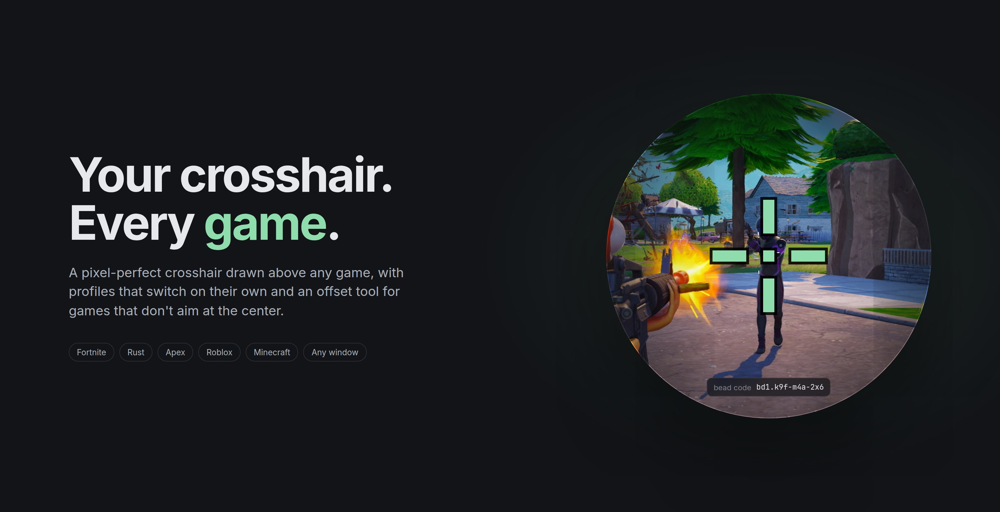
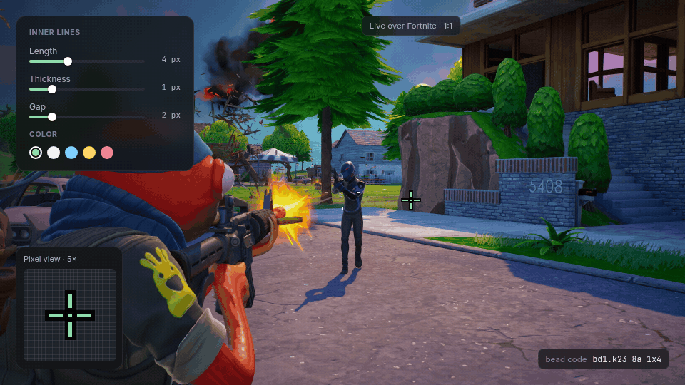
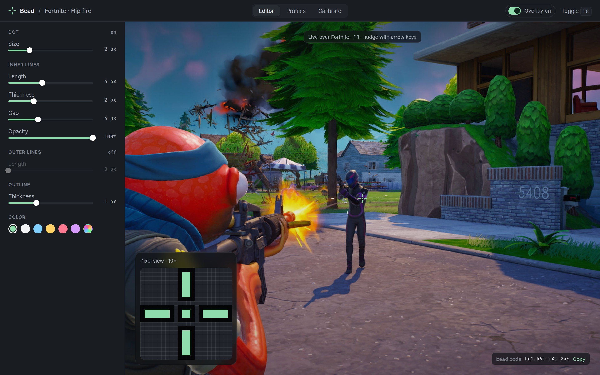
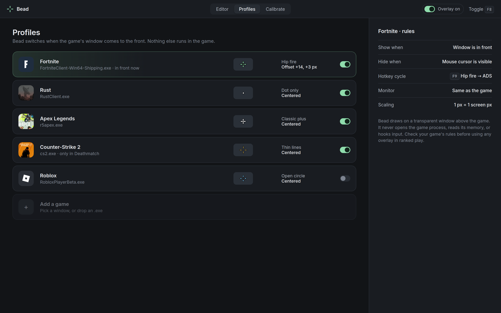
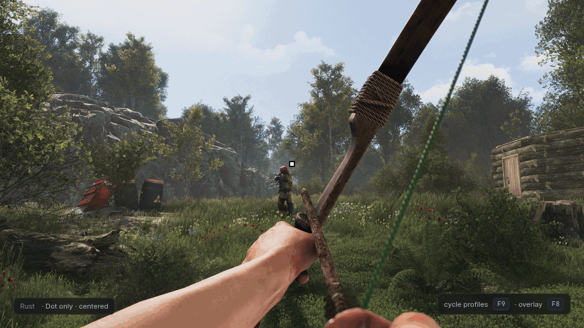
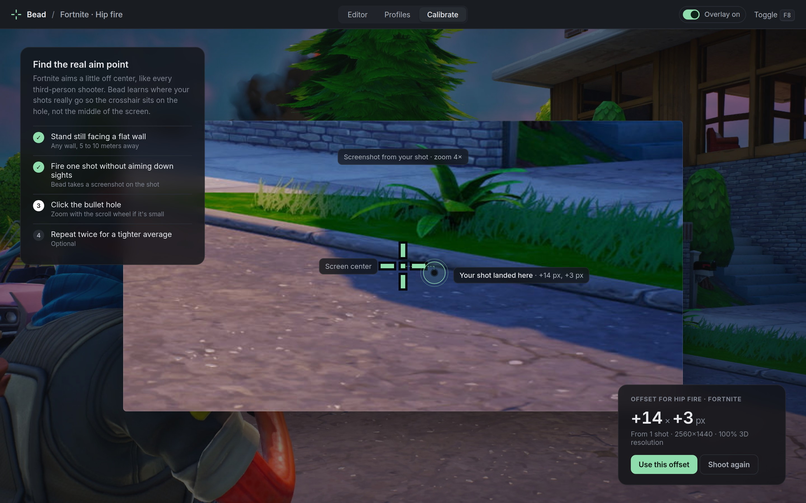

# Bead — custom crosshair overlay for Fortnite, Rust and any game

  
  
  
  

<h2 align="center">Bead</h2>

<b>A pixel-perfect crosshair drawn above any game. Profiles switch when the game comes to the front, and a two-step calibration puts the crosshair where your shots actually land.</b>

<b>Free · Windows 10 and 11 · open source.</b> <b>v1.2.6 is out now</b> — grab it from <a href="releases/latest">Releases</a>.

## See it work

Drag a slider and the crosshair on your game changes in the same frame. The pixel view shows the exact pixels, and the bead code updates so you can share what you made.

## What Bead will do

- Draws a pixel-perfect crosshair on a transparent window above any game, including games with no crosshair at all, such as Rust or Fortnite in hip fire.
- Lets you build the crosshair from dot, inner lines, outer lines, outline and color, in whole screen pixels, with a 10× pixel view.
- Keeps one profile per game and switches it when that game's window comes to the front, hiding when the mouse cursor appears in menus.
- Calibrates the real aim point for third-person games: fire one shot at a wall, click the hole, and the crosshair moves there.
- Shares crosshairs as short bead codes and imports Valorant and Counter-Strike crosshair codes.
- Never opens the game process, reads its memory or hooks input.

## Why another crosshair app

Most overlays give you a crosshair in the middle of the screen and stop there. Bead is built around three things the others get wrong.

- **Pixel-perfect at 1:1.** Every value is in screen pixels, there is no scaling blur, and a 10× pixel view shows exactly what the game will show.
- **The real aim point.** Third-person games aim off center. Fire one shot at a wall, click the hole, and Bead moves the crosshair there.
- **Hands off the game.** Bead is a transparent, click-through window on top. It never opens the game process, reads memory, or hooks input.

## Screens

### Editor

Dot, inner lines, outer lines, outline, color. Every slider is in whole pixels. The pixel view is the truth: what you see there is what lands on screen.

### Profiles

One crosshair per game, matched by window or process. Bead shows it when the game is in front and hides it when the cursor appears in menus. A hotkey cycles between variants, for instance hip fire and ADS.

Alt-tab from Rust to Fortnite and the crosshair follows: different shape, different color, and the offset you calibrated for that game.

### Calibrate

Stand at a wall, fire once, click the hole. Bead takes the screenshot for you and turns the distance into an offset for that profile. Repeat for a tighter average.

## Bead codes

A crosshair is a short string like `bd1.k9f-m4a-2x6`. Paste one into the editor to load it, copy one to share it. The plan is to also import Valorant and Counter-Strike crosshair codes, since those formats are public.

## How it will work

1. A borderless, topmost, click-through window the size of the game's monitor, drawn with a transparent backdrop.
2. A watcher that follows the foreground window and switches profiles by process name or window title.
3. Calibration takes a screenshot on your shot key, lets you mark the hole, and stores the offset per profile.
4. No injection, no hooks into the game, no reading of game memory. Bead works the same for any window, including a video or a browser.

## Anti-cheat and fairness

An external overlay draws on your screen and nothing else. Even so, every game has its own rules about overlays and some ranked modes forbid them. Read your game's rules before using Bead in competitive play. Bead is not affiliated with any game or publisher.

## FAQ

**Will this get me banned?**
Bead never touches the game. It draws on its own transparent window, the way a sticker on your monitor would. Every game still sets its own rules about overlays, so read them before ranked play.

**Does it cost FPS?**
The overlay is one small static image. It redraws only when you change the crosshair or switch games.

**Does it work in exclusive fullscreen?**
It needs borderless or windowed fullscreen, which is what Fortnite and most current games use by default.

**Why would I need a crosshair in Fortnite?**
Hip fire has bloom and no fixed dot, and the aim point sits off the center of the screen. A calibrated dot shows where the first shot goes.

## Get it

Download [`custom-crosshair-overlay-any-game.zip`](releases/latest) — v1.2.6, Windows 10 and 11. Unpack the folder and start `Bead.exe`.

## Roadmap

- [x] Brand, icon and screens
- [ ] Overlay window with pixel-exact drawing
- [ ] Editor with bead codes
- [ ] Profiles with foreground-window switching
- [ ] Calibration flow
- [ ] Valorant and Counter-Strike code import

## Credits

Screens show a Fortnite screenshot and the Fortnite mark (Epic Games), a screenshot and library art from Rust (Facepunch Studios), and library art from Apex Legends (Electronic Arts) and Counter-Strike 2 (Valve), used to illustrate how an overlay looks over a real game. These belong to their owners and are not part of this project. Bead is not affiliated with or endorsed by Epic Games.  Bead's own code, brand and screens are [MIT](LICENSE).

## About this repo

**Description:** Custom crosshair overlay for any game: pixel-perfect editor, per-game profiles that switch on their own, offset calibration for third-person shooters. No injection, no game hooks.

**Topics:** crosshair, crosshair-overlay, custom-crosshair, fortnite-crosshair, gaming-overlay, fortnite, rust, apex-legends, windows
